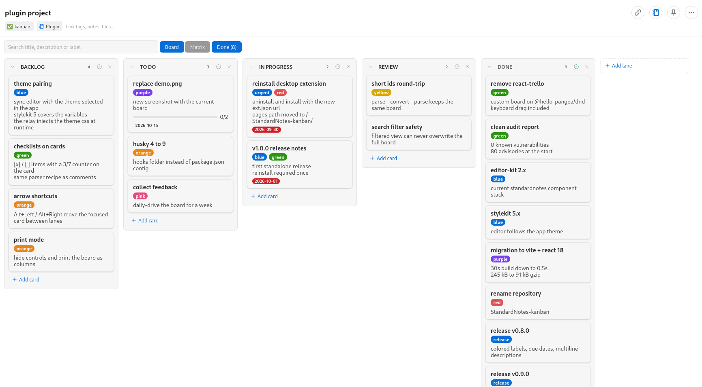
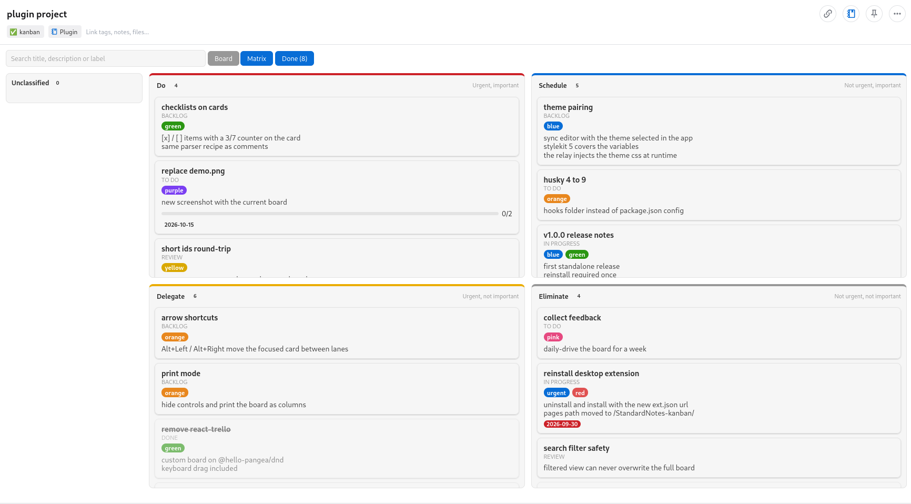

# StandardNotes Kanban

[](https://github.com/Esl1h/StandardNotes-kanban/actions/workflows/ci.yml)
[](https://github.com/Esl1h/StandardNotes-kanban/actions/workflows/coverage.yml)
[](https://github.com/Esl1h/StandardNotes-kanban/releases/latest)
[](LICENSE)

A Kanban board editor for [Standard Notes](https://standardnotes.com), a
free, open-source, end-to-end encrypted notes app. Your board is stored as
plain Markdown inside the note, so it stays readable, exportable and
portable.



## Features

1. Manage lanes and cards with titles, descriptions, labels, checklists,
   due dates and comments
2. Drag and drop cards between lanes (and reorder them inside a lane),
   with keyboard drag support
3. Reorder, rename and collapse lanes (collapsed lanes are remembered per note on each device); card counts in lane headers. The `⋮` lane menu marks the lane as done, completes or deletes all its cards, or deletes the lane, each with an Undo
4. Edit card descriptions, labels, due dates and comments in a card modal
5. Search across titles, descriptions and labels. Narrow it down with `label:name` and `due:overdue`, `due:today` or `due:week`, typed in the search or toggled from the filter bar under it; clicking a label on a card filters by that label
6. Keyboard shortcuts: `N` adds a card, `Ctrl/Cmd+F` focuses search, `Ctrl/Cmd+Z` and `Ctrl/Cmd+Shift+Z` undo and redo changes to the board, `Alt+Left/Right` moves the focused (last clicked) card to the adjacent lane. The card modal also has a "Move to" select to send the card to any lane
7. Your board lives in the note as Markdown; read or tweak it with any
   other editor without breaking the board
8. Works with the Standard Notes web and desktop apps; follows the theme
   selected in the app
9. Mark lanes as done lanes: they are hidden from the board, and a `Done (N)` toolbar button shows or hides them. Completing a card sends it to the first done lane. While it is shown, `Clear done` removes the finished cards, with an Undo
10. Switch to an Eisenhower matrix with the `Board | Matrix` toggle: the
    same cards sorted into Do, Schedule, Delegate and Eliminate, plus an
    Unclassified list. Drag cards between quadrants or pick one in the
    card modal; rename a quadrant by clicking its title. The chosen view
    is remembered per note on each device. On a phone each section can be folded away from its heading
11. Take the board out of the note with the `Export` menu: copy or download everything as JSON, or one row per card as CSV



## Installation

1. Run the Standard Notes web or desktop app.
2. Click the **Preferences** (gear) icon.
3. Select **Plugins** in the Preferences menu.
4. Scroll to the bottom and paste this URL into the
   **Install Custom Plugin** box:

   ```
   https://esli.cafe/StandardNotes-kanban/ext.json
   ```

5. Confirm the installation.
6. Create a new note, open the **Editor** menu and pick **Kanban**.
7. Add a lane, add some cards, and have fun!

## Verifying a release

Releases published from November 2026 on attach a `SHA256SUMS` file and a build provenance attestation next to `extension.zip`, the package the desktop app installs. To check a downloaded zip, run in the folder that holds both files:

```
sha256sum -c SHA256SUMS
gh attestation verify extension.zip -R Esl1h/StandardNotes-kanban
```

The second command confirms that the zip was built by this repository's release workflow from the tagged commit. Releases are immutable: once published, their tag and files cannot be changed.

## Note format

The board is saved in the note body as Markdown. One `#` heading per lane,
one `*` bullet per card, indented `*` bullets for card fields:

```
Quadrants: Now | Plan | Hand off | Drop
Labels: work=blue

# To Do
* Write the report [id:a3f9k2]
  * Description: Q4 numbers, then review with the team
    > bring the spreadsheet
  * Due: 2026-09-30
  * Label: work, blue
  * Quadrant: do
  * Checklist:
    [x] first draft
    [ ] review with the team
  * Comments:
    * First draft looks good
* Call the bank

# Done [done]
* Book the flights
```

- `Description` spans multiple lines: continue it with ` >` lines
- `Label` takes a comma separated list; any text works as a label. A
  label gets its color from the `Labels:` line below, or from the
  palette when the label is itself a palette name (`red`, `orange`,
  `yellow`, `green`, `blue`, `purple`, `pink`); otherwise it renders as
  a neutral chip
- The optional `Labels:` line before the first lane assigns a palette
  color per label name (`Labels: work=blue, urgent=red`); the card
  modal offers the swatches, and the color applies to every card with
  that label
- `Due` takes a `YYYY-MM-DD` date; the card shows an overdue/today badge
- `Checklist` is a header line followed by ` [x] item` (done) and
  ` [ ] item` (pending) sub-items; the card shows a `3/7` counter with
  a progress bar, and the modal edits the items
- `Quadrant` places the card in the Eisenhower matrix; it takes a fixed
  key (`do`, `schedule`, `delegate`, `eliminate`), so renaming a
  quadrant never rewrites cards
- `[done]` after a lane title marks a done lane; several lanes can
  carry it, and the first one receives the completed cards
- The optional `Quadrants:` line before the first lane holds renamed
  quadrant names, in the order Do | Schedule | Delegate | Eliminate; it
  is only written when a name differs from the default
- The `[id:xxxxxx]` markers are managed by the editor and keep drag and
  modal references stable between loads; they are recreated
  automatically when missing

Notes saved by the very first release of this editor (raw JSON) are
detected and converted to Markdown automatically the first time they are
edited. Lines the parser cannot understand are kept as-is in the note and
reported in a banner at the top of the board.

## Privacy

Everything is stored inside your Standard Notes note, so it is encrypted
with the rest of your data. The editor itself does not send anything
anywhere.

## Development and running locally

**Prerequisites:**

1. (Optional) Fork this repo on GitHub.
2. [Clone](https://docs.github.com/en/repositories/creating-and-managing-repositories/cloning-a-repository)
   this repo or your fork.
3. Run `cd StandardNotes-kanban` and then `npm install` to install all
   dependencies.

### Testing in the browser (standalone)

1. Run:

```
npm start
```

2. Your browser may open automatically. If not, open
   `http://localhost:3001/`. The standalone editor runs without a Standard
   Notes context, so saving is disabled but the UI is fully usable.
3. When you're done, press `Ctrl/Cmd + C` in the console to stop the app.

### Testing inside your local Standard Notes app

1. Run `npm run build` to build the app, then:

```
npm run server
```

2. In Standard Notes, follow the Installation steps above but paste:

```
http://localhost:3000/ext.dev.json
```

The dev extension uses a separate identifier (`Kanban (Dev)`) so it does
not clash with the hosted one.

3. When you're done, press `Ctrl + C` to shut down the server.

If you run into issues, please refer to the
[Standard Notes instructions for local plugin setup](https://standardnotes.com/help/plugins/local-setup).

### Releases

The extension is hosted on GitHub Pages from the `gh-pages` branch, served at `https://esli.cafe/StandardNotes-kanban/`. To cut a release:

1. On a branch, run `npm run version:bump X.Y.Z`, which writes the version to `package.json`, `package-lock.json`, `public/package.json`, `public/ext.json` (with its `download_url`) and `public/ext.dev.json`, then `npm run changelog -- --tag vX.Y.Z`, which adds the section for the new version to `CHANGELOG.md` from the commits since the last tag. Commit both as `chore(release): vX.Y.Z` and merge the pull request.
2. On `main`, push the tag:

```
git tag -a vX.Y.Z -m vX.Y.Z && git push origin vX.Y.Z
```

The `Release` workflow fails unless the tag matches every version file. It runs the checks, attaches `extension.zip` (the package the desktop app installs) with `SHA256SUMS` and a provenance attestation to the GitHub release, writes the release notes with git-cliff and publishes the hosted build to Pages. The app finds the update by comparing the version in the `ext.json` at `latest_url`.

## Credits and license

- Board concept and early versions by
  [corvec](https://github.com/corvec) (sn-kanban-editor)
- Built on [Standard Notes](https://standardnotes.com) and
  [@standardnotes/component-relay](https://github.com/standardnotes/component-relay)
- Licensed under [AGPL-3.0](LICENSE) or later
